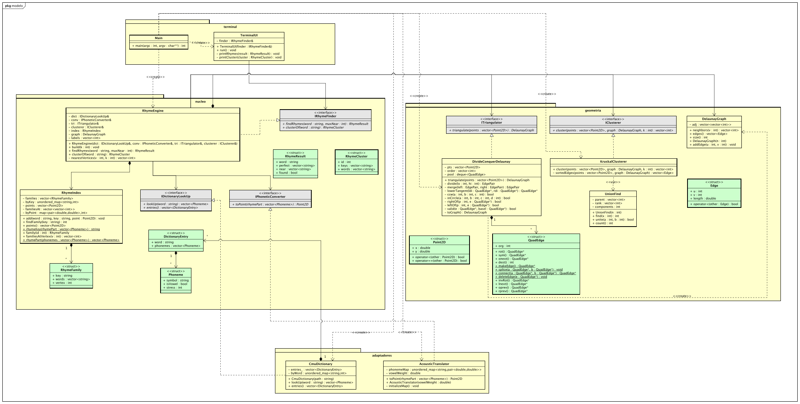

# G58_Dividir_e_Conquistar_PA_26.2

**Número da Lista**: 58<br>
**Conteúdo da Disciplina**: Dividir e Conquistar<br>
**Nome da aplicação**: Buscador de rimas<br>
**Status**: implementado em C++17, com programa de linha de comando e suíte de testes automáticos.

## Alunos

| Matrícula | Aluno |
| -- | -- |
| 231011696 | Luiz Guilherme Morais da Costa Faria |

## Sobre

O programa encontra rimas para palavras em inglês. Para cada palavra, ele mostra as **rimas perfeitas** (palavras com a mesma terminação sonora, como *dog*, *blog* e *catalogue*) e as **rimas próximas** (terminações parecidas, como *chalk* e *catwalk*). Também mostra o **grupo de rimas** (cluster) ao qual a palavra pertence.

A pronúncia vem do CMU Pronouncing Dictionary, com 135.166 entradas. A terminação sonora de cada palavra vira um ponto no plano, e palavras que rimam parecido ficam perto umas das outras. O centro do trabalho é a **triangulação de Delaunay por dividir e conquistar** (Guibas e Stolfi), que liga cada ponto aos seus vizinhos naturais em Θ(n log n). Sobre essa triangulação, o programa:

- busca as rimas próximas andando pelo grafo, sem comparar com todos os pontos;
- forma os grupos de rimas com o algoritmo de Kruskal, usando só as ~3n arestas da triangulação em vez das n(n − 1)/2 do grafo completo.

Com o dicionário inteiro, são 34.107 famílias de rima em 18.240 pontos distintos, ligados por 54.669 arestas. O programa fica pronto para consultas em menos de 150 ms.

## Instalação

**Linguagem**: C++17 (mais o `predicates.c` de Shewchuk, em C)<br>
**Compilador**: Clang ou GCC<br>
**Build**: CMake 3.20 ou superior<br>
**Testes**: GoogleTest 1.15.2, baixado automaticamente pelo CMake na primeira configuração (precisa de internet)<br>
**Dados**: o dicionário já vem no repositório, em `data/cmudict.dict`.

No terminal, dentro da pasta do projeto:

```bash
cmake -S . -B build-release -DCMAKE_BUILD_TYPE=Release
cmake --build build-release
```

Isso gera três executáveis: `rhyme` (o programa), `build-release/tests/rhyme_tests` (os testes) e `rhyme_bench` (o benchmark). Os três usam a mesma biblioteca de classes, `rhyme_core`.

## Uso

```bash
./build-release/rhyme [dicionário] [k]
```

| Argumento | Significado | Padrão |
| -- | -- | -- |
| `dicionário` | caminho do arquivo do CMU | `data/cmudict.dict` |
| `k` | número de grupos de rimas formados pelo Kruskal | `15` |

O caminho padrão é relativo: rode o programa a partir da raiz do projeto. Ao abrir, o programa lê o dicionário, monta o índice, a triangulação e os grupos, mostra quanto tempo levou e espera comandos:

| Comando | O que faz |
| -- | -- |
| `rimas <palavra> [n]` | Rimas perfeitas e as `n` rimas próximas mais parecidas (padrão: 10) |
| `cluster <palavra>` | O grupo de rimas da palavra: quantas famílias e palavras tem, e as primeiras palavras |
| `ajuda` | Lista os comandos |
| `sair` | Encerra (Ctrl+D também) |

As palavras podem ser digitadas em maiúsculas ou minúsculas. Listas longas mostram as 20 primeiras palavras e quantas sobraram. Um dicionário que não abre ou um `k` inválido (que não é número, ou fora do intervalo de 1 até o número de pontos) mostram a mensagem de erro e encerram com código de saída 1.

Para rodar a sequência de comandos usada no teste manual:

```bash
./build-release/rhyme < tests/roteiro_terminal.txt
```

## Algoritmos e modelagem

### Da palavra ao ponto

1. **Pronúncia.** O dicionário traz cada palavra com seus fonemas. As vogais carregam um dígito de tonicidade: 1 (primária), 2 (secundária) ou 0 (átona). Exemplo: `dog D AO1 G`.
2. **Parte da rima.** É o trecho que precisa coincidir para duas palavras rimarem: da **última vogal tônica** (1 ou 2) até o fim. Se nenhuma vogal for tônica, usa a última vogal; palavras sem vogal são ignoradas (8 no dicionário inteiro).

   | Palavra | Fonemas | Parte da rima |
   | -- | -- | -- |
   | dog | D AO1 G | AO G |
   | banana | B AH0 N AE1 N AH0 | AE N AH |
   | notebook | N OW1 T B UH2 K | UH K |
   | the | DH AH0 | AH |

3. **Família de rima.** A parte da rima vira uma chave de texto (`"AO G"`). Palavras com a mesma chave são **rimas perfeitas** entre si e formam uma família.
4. **Ponto no plano.** Cada um dos 39 fonemas do CMU tem uma coordenada. As vogais estão dispostas como no trapézio vocálico (posição da língua: anterior ou posterior, alta ou baixa). As consoantes estão dispostas pelo ponto de articulação (eixo x) e pelo modo de articulação (eixo y), com as sonoras logo acima das surdas. O ponto da família é

   ```text
   ponto = 0,9 · (coordenada da vogal tônica) + 0,1 · (média das coordenadas do resto)
   ```

   Exemplo: AO = (0,90, 0,40) e G = (0,80, 0,15), então "AO G" vira (0,89, 0,375). O peso 0,9 da vogal faz as rimas se agruparem pela vogal tônica, que é o que mais pesa para o ouvido.
5. **Vértices.** Famílias diferentes podem cair no mesmo ponto (por exemplo, os mesmos fonemas em ordem diferente). O índice junta essas famílias num único vértice: as 34.107 famílias viram 18.240 pontos distintos.

### Triangulação de Delaunay por dividir e conquistar

Dado um conjunto de pontos no plano, queremos ligá-los em triângulos de modo que **nenhum ponto fique dentro do círculo que passa pelos três vértices de algum triângulo**. Essa triangulação contém o par de pontos mais próximo, liga cada ponto ao seu vizinho mais próximo e contém a árvore geradora mínima do grafo completo. Por isso ela serve de base para as rimas próximas e para os grupos.

```text
triangular(pontos):
    ordenar os índices dos pontos por (x, y)         O(n log n), uma vez só
    recusar pontos repetidos
    dividir(0, n)

dividir(lo, hi):                                      intervalo [lo, hi)
    se hi − lo = 2: devolve uma aresta
    se hi − lo = 3: devolve um triângulo (ou duas arestas, se alinhados)
    mid = (lo + hi) / 2
    esquerda = dividir(lo, mid)
    direita  = dividir(mid, hi)
    devolve merge(esquerda, direita)

merge(esquerda, direita):
    basel = tangente inferior comum (a aresta mais baixa ligando as duas metades)
    repetir:
        candidatos acima de basel: lcand (na metade esquerda) e rcand (na direita)
        apagar os candidatos cujo círculo contém o próximo vizinho
        se nenhum candidato é válido: pare (basel chegou à tangente superior)
        vence o candidato cujo círculo não contém o ponto do outro
        basel = nova aresta ligando a base ao candidato vencedor
```

- **Dividir.** Com os pontos ordenados por x, cortar o intervalo de índices ao meio separa o plano em uma metade esquerda e uma direita.
- **Conquistar.** Cada metade é triangulada recursivamente, até os casos base de 2 e 3 pontos.
- **Combinar.** O merge costura as duas metades de baixo para cima, como um zíper: parte da tangente inferior, apaga as arestas que deixaram de ser Delaunay e acrescenta as novas, até a tangente superior.

**Complexidade.** O merge é linear no número de pontos das duas metades: cada passo do zíper cria uma aresta ou apaga uma, e uma triangulação de n pontos tem no máximo 3n − 6 arestas. A recorrência é

```text
T(n) = 2 T(n/2) + Θ(n)
```

Pelo Teorema Mestre (a = 2, b = 2, f(n) = Θ(n) = Θ(n^(log₂ 2)), caso 2), **T(n) = Θ(n log n)**. A ordenação inicial também custa O(n log n) e é feita uma vez só, fora da recursão. O resultado é ótimo: a partir da triangulação de pontos sobre uma parábola dá para ordenar números, então nenhum algoritmo baseado em comparações faz melhor que Ω(n log n). A triangulação final ocupa O(n) de memória.

**Estrutura de dados: quad-edge.** Cada aresta é guardada em quatro versões dirigidas (a aresta, a do sentido oposto e as duas rotações do grafo dual), cada uma com o ponteiro para a próxima aresta que gira em torno da mesma origem. As quatro operações de Guibas e Stolfi (`makeEdge`, `splice`, `connect` e `deleteEdge`) bastam para todo o algoritmo. As arestas moram numa arena (`std::deque`), que não move os elementos quando cresce, então os ponteiros continuam válidos; as apagadas ficam marcadas e são ignoradas na conversão para grafo.

**Predicados robustos.** O algoritmo só faz duas perguntas geométricas: "o ponto está à esquerda da aresta?" (`orient2d`) e "o ponto está dentro do círculo?" (`incircle`). Com `double` comum, pontos quase alinhados recebem a resposta errada e o merge se perde. O projeto usa os predicados de precisão adaptativa de Shewchuk, que dão sempre o sinal exato e só gastam aritmética extra nos casos difíceis. No exemplo clássico de Kettner e outros (um ponto a poucos dígitos da reta que passa por (12, 12) e (24, 24)), a conta direta erra o lado em **1.442 de 4.096 casos**; o `orient2d` acerta todos.

### Rimas próximas: busca pelo grafo

As rimas próximas de uma palavra são as palavras dos vértices mais perto do vértice dela. Em vez de comparar com os 18.240 pontos, a busca anda pelo grafo da triangulação a partir do vértice da palavra, com uma fila de prioridade ordenada pela distância até ele: a cada passo sai o vértice mais próximo ainda não visitado, e os vizinhos dele entram na fila. Isso dá o resultado exato porque, na triangulação de Delaunay, o i-ésimo vizinho mais próximo de um ponto é sempre vizinho de algum dos anteriores.

A lista começa pelas outras famílias do mesmo vértice (distância zero) e segue em ordem de distância, sem repetir palavras nem incluir as rimas perfeitas, até completar `n` palavras.

### Grupos de rimas: Kruskal sobre a triangulação

Os grupos são formados por ligação simples: as arestas são ordenadas pelo comprimento, e o Kruskal une os pontos de cada aresta (com union-find, compressão de caminho e união por posto) até sobrarem `k` componentes. A árvore geradora mínima está sempre dentro da triangulação de Delaunay, então usar só as arestas dela dá **exatamente os mesmos grupos** que usar o grafo completo (há um teste que confere isso). O custo cai de O(n² log n) para **O(E log E) com E ≤ 3n − 6, ou seja, O(n log n)**.

### Arquitetura: portas e adaptadores

O núcleo (`RhymeEngine` e `RhymeIndex`) só conhece interfaces:

| Interface | Papel | Implementação |
| -- | -- | -- |
| `IRhymeFinder` | porta de entrada: o que o núcleo oferece | `RhymeEngine`, usada pela `TerminalUI` |
| `IDictionaryLookUp` | pronúncias | `CmuDictionary` |
| `IPhoneticConverter` | da parte da rima ao ponto | `AcousticTranslator` |
| `ITriangulator` | triangulação | `DivideConquerDelaunay` |
| `IClusterer` | grupos | `KruskalClusterer` |

O `main` é o único lugar que conhece as classes concretas: ele monta as peças e as entrega ao núcleo. Isso permite trocar qualquer peça sem mexer no resto. Os testes aproveitam isso, por exemplo, com um conversor falso que põe todas as rimas no mesmo ponto.

## Organização do código

| Pasta ou arquivo | Responsabilidade |
| -- | -- |
| `modelo/terminal/main.cpp` | Ponto de entrada: lê os argumentos, monta as peças e chama `build(k)` |
| `modelo/terminal/` | `TerminalUI`: laço de comandos e impressão dos resultados |
| `modelo/nucleo/` | `RhymeEngine` (`build`, `findRhymes`, `clusterOf`), `RhymeIndex`, as interfaces do núcleo e as structs `Phoneme`, `DictionaryEntry`, `RhymeFamily`, `RhymeResult` e `RhymeCluster` |
| `modelo/adaptadores/` | `CmuDictionary` (leitura do dicionário) e `AcousticTranslator` (fonemas para ponto) |
| `modelo/geometria/` | `DivideConquerDelaunay`, `QuadEdge`, `predicates.c` (Shewchuk), `DelaunayGraph`, `KruskalClusterer`, `UnionFind`, `Point2D`, `Edge`, `ITriangulator` e `IClusterer` |
| `tests/` | Suíte de testes, oráculos de força bruta (`BruteForce.hpp`), dicionário de exemplo (`fixtures/mini.dict`) e roteiro do terminal |
| `bench/` | `bench_delaunay.cpp`, o programa de benchmark |
| `data/` | `cmudict.dict`, o dicionário do CMU |
| `docs/diagramas/` | Diagramas UML |

## Experimentos e comparação

O `rhyme_bench` mede a triangulação, o Kruskal e o par mais próximo em conjuntos de pontos aleatórios (uniformes em [0, 1)², com semente fixa), e o programa inteiro com o dicionário real:

```bash
./build-release/rhyme_bench [dicionário]
```

Os resultados abaixo foram obtidos num Mac com Apple Silicon (arm64), compilados com AppleClang 21 em Release (`-O3 -DNDEBUG`). Cada tempo é a mediana de 5 execuções.

### Triangulação de Delaunay

| n | Arestas | Tempo (ms) | t / (n log₂ n) (ns) |
|---:|---:|---:|---:|
| 1.000 | 2.977 | 0,86 | 86,3 |
| 2.000 | 5.975 | 1,68 | 76,6 |
| 4.000 | 11.976 | 3,42 | 71,4 |
| 8.000 | 23.973 | 9,55 | 92,1 |
| 16.000 | 47.971 | 15,31 | 68,5 |
| 32.000 | 95.974 | 31,89 | 66,6 |
| 64.000 | 191.970 | 69,43 | 67,9 |
| 128.000 | 383.966 | 155,78 | 71,7 |

A última coluna fica em torno de 70 ns enquanto n cresce 128 vezes: é o comportamento Θ(n log n) previsto pela recorrência. A linha de 8.000 pontos destoa por ruído de medição, comum em tempos de poucos milissegundos.

### Kruskal sobre a Delaunay x sobre o grafo completo (k = 10)

| n | Arestas (Delaunay) | Triangulação (ms) | Kruskal na Delaunay (ms) | Total (ms) | Arestas (completo) | Kruskal no completo (ms) |
|---:|---:|---:|---:|---:|---:|---:|
| 500 | 1.479 | 0,29 | 0,07 | 0,36 | 124.750 | 7,16 |
| 1.000 | 2.980 | 0,65 | 0,16 | 0,81 | 499.500 | 32,01 |
| 2.000 | 5.978 | 1,53 | 0,34 | 1,87 | 1.999.000 | 141,72 |
| 5.000 | 14.977 | 3,81 | 1,00 | 4,81 | 12.497.500 | 1.004,30 |

Mesmo somando o tempo da triangulação, o caminho pela Delaunay é cerca de 200 vezes mais rápido com 5.000 pontos, e a diferença cresce com n: ao dobrar n, o grafo completo leva quatro vezes mais tempo, e a Delaunay, pouco mais que o dobro.

### Par mais próximo: menor aresta da Delaunay x força bruta

| n | Delaunay (ms) | Força bruta (ms) | Mesma distância? |
|---:|---:|---:|:---:|
| 1.000 | 0,75 | 0,62 | sim |
| 2.000 | 1,50 | 2,37 | sim |
| 4.000 | 3,25 | 9,50 | sim |
| 8.000 | 6,85 | 37,96 | sim |
| 16.000 | 14,57 | 150,57 | sim |
| 32.000 | 30,53 | 602,90 | sim |

A força bruta, O(n²), só é mais rápida com 1.000 pontos. A partir de 2.000 a Delaunay vence, e com 32.000 pontos é 20 vezes mais rápida, sempre com a mesma distância.

### Dicionário inteiro do CMU

| Etapa | Tempo (ms) |
| -- | --: |
| Ler o dicionário (135.166 entradas) | 83,0 |
| `build(15)`: índice, triangulação e Kruskal | 63,0 |

| Medida | Valor |
| -- | --: |
| Famílias de rima | 34.107 |
| Pontos distintos | 18.240 |
| Arestas da triangulação | 54.669 (limite 3n − 6 = 54.714) |
| Grafo conexo | sim |

## Screenshots

### Exemplo de execução

```text
$ ./build-release/rhyme
Índice pronto em 63ms (k = 15)
Digite 'ajuda' para ver os comandos.
> rimas dog
Rimas perfeitas (31):
 acog, analog, analogue, backlog, blog, bog, bulldog, bullfrog, catalogue, cog, dialogue, eggnog, epilogue, fog, gundog, haug, hotdog, lapdog, leapfrog, log ... (+ 11)
Rimas próximas (10):
 airlock, balk, blackhawk, boardwalk, calk, catwalk, caulk, chalk, cornstalk, crosstalk
> cluster dog
Cluster 2: 2224 famílias, 7997 palavras
 'course, agresource, borse, bourse, clotheshorse, coarse, concourse, corse, counterforce, course, deadhorse, divorce, endorse, enforce, ensource, force, forse, fourths, gencorp's, gift-horse ... (+ 7977)
> rimas xyzzy
Palavra não encontrada: xyzzy
> sair
```

### Diagramas



<!-- Acrescente aqui os diagramas de sequência e o de atividades da recursão quando forem exportados para docs/diagramas/. -->

## Validação

```bash
cmake -S . -B build-debug -DCMAKE_BUILD_TYPE=Debug
cmake --build build-debug --target rhyme_tests
./build-debug/tests/rhyme_tests
```

O projeto foi desenvolvido com TDD: cada método começou por um teste que falhava. São **79 testes** em GoogleTest, e o executável retorna código 0 se todos passarem. A suíte também foi executada com o AddressSanitizer e o UndefinedBehaviorSanitizer, sem erros:

```bash
cmake -S . -B build-asan -DCMAKE_BUILD_TYPE=Debug \
      -DCMAKE_CXX_FLAGS="-fsanitize=address,undefined" -DCMAKE_C_FLAGS="-fsanitize=address,undefined"
cmake --build build-asan --target rhyme_tests
./build-asan/tests/rhyme_tests
```

| Camada | Testes | O que cobre |
| -- | --: | -- |
| geometria | 31 | `UnionFind`, `DelaunayGraph`, `Point2D` e `Edge`, `KruskalClusterer`, as quatro operações da `QuadEdge`, os predicados e o `DivideConquerDelaunay`: 2 e 3 pontos (nos dois sentidos e alinhados), tangente inferior, quadrado, ponto interno, arestas apagadas nos dois lados do merge, pontos alinhados na horizontal e na vertical, grade 10×10 (261 arestas), embaralhamento da entrada e ponto repetido |
| núcleo | 25 | `RhymeIndex` (chave e parte da rima, famílias, vértices compartilhados, palavras repetidas) e `RhymeEngine` (grupos, rimas perfeitas e próximas, ordem por distância, maiúsculas e um conversor falso para o vértice compartilhado) |
| adaptadores | 16 | `AcousticTranslator` (pesos, média, os 39 fonemas, símbolo desconhecido) e `CmuDictionary` (comentários, variantes como `log(2)`, maiúsculas, arquivo inexistente) |
| oráculos e dados reais | 7 | Delaunay igual à calculada pela definição em 200 conjuntos aleatórios, menor aresta igual ao par mais próximo, vizinho mais próximo no grafo, árvore geradora igual à do Prim, mesmos grupos que no grafo completo, predicados com pontos quase alinhados e a triangulação do dicionário inteiro (conexa e com no máximo 3n − 6 arestas) |

Os testes de oráculo comparam as versões rápidas com contas de força bruta que seguem a definição ao pé da letra, como a triangulação em O(n⁴). A `TerminalUI` foi conferida pelo roteiro `tests/roteiro_terminal.txt`.

## Outros

Limitações conhecidas:

- **A projeção em 2D perde informação.** O ponto de uma rima é uma média ponderada, então a ordem dos fonemas se perde e terminações bem diferentes podem cair perto. As rimas perfeitas não são afetadas, mas algumas rimas próximas soam estranhas (para *love*, aparecem *grumpier* e *colombia*).
- **Os grupos ficam desbalanceados.** A ligação simples do Kruskal tende a encadear pontos; sem o peso 0,9 da vogal, quase todos os pontos caem num grupo só. Mesmo com o peso, com k = 15 surgem grupos de milhares de palavras ao lado de grupos com um único ponto isolado.
- **Só palavras do dicionário.** Uma palavra fora do CMU não é encontrada, porque o programa não deduz a pronúncia pela escrita. Para palavras com mais de uma pronúncia, a consulta usa a primeira, mas todas entram no índice.
- **As rimas próximas não têm distância máxima.** O programa sempre completa `n` palavras, mesmo que as últimas já estejam longe.

Trabalhos futuros:

- **Paralelizar o dividir e conquistar.** As duas chamadas recursivas são independentes e podem rodar em paralelo, mas o merge é sequencial e linear: o caminho crítico custa O(n), então o ganho máximo é da ordem de log n. Com o dicionário real, a triangulação leva poucos milissegundos, e o tempo total é dominado pela leitura do arquivo.
- **Usar a engine num aplicativo de escrita de poemas.** Pela arquitetura de portas e adaptadores, um aplicativo seria só mais um adaptador de entrada sobre o `IRhymeFinder`.

Créditos e licenças:

- **CMU Pronouncing Dictionary** (repositório `cmusphinx/cmudict`), Carnegie Mellon University, licença BSD de 2 cláusulas.
- **Predicados robustos** (`predicates.c`) de Jonathan Richard Shewchuk, em domínio público.

Referências:

- L. Guibas e J. Stolfi. *Primitives for the manipulation of general subdivisions and the computation of Voronoi diagrams*. ACM Transactions on Graphics, 4(2):74–123, 1985.
- J. R. Shewchuk. *Adaptive precision floating-point arithmetic and fast robust geometric predicates*. Discrete & Computational Geometry, 18(3):305–363, 1997.
- L. Kettner, K. Mehlhorn, S. Pion, S. Schirra e C. Yap. *Classroom examples of robustness problems in geometric computations*. Computational Geometry, 40(1):61–78, 2008.
- T. H. Cormen, C. E. Leiserson, R. L. Rivest e C. Stein. *Introduction to Algorithms*, 3ª ed. MIT Press, 2009 (Teorema Mestre e algoritmo de Kruskal).
